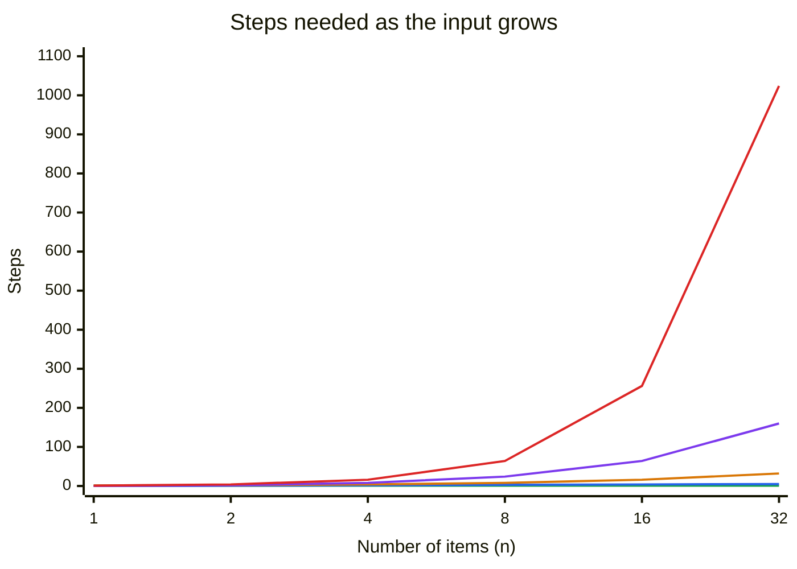

# 1. Big O

## Fast today, slow tomorrow

An online shop wants to check whether any order number appears twice in today's orders. Here's a straightforward way: compare every order with every other order.

```python
def has_duplicates_slow(items):
    for i in range(len(items)):
        for j in range(i + 1, len(items)):
            if items[i] == items[j]:
                return True
    return False
```

It works, and with 100 orders it's instant. Here's how long it took on one laptop as the number of orders grew, when there were no duplicates so it had to check everything:

| Orders | Time |
|---|---|
| 1,000 | 0.04 seconds |
| 2,000 | 0.10 seconds |
| 4,000 | 0.24 seconds |
| 8,000 | 0.99 seconds |

Each time the number of orders **doubles**, the time roughly **quadruples**. At 100,000 orders it would take about two and a half minutes. At a million, over four hours. The code didn't get worse: the data got bigger, and this code reacts badly to that.

Here's another version that does the same job:

```python
def has_duplicates_fast(items):
    seen = set()
    for item in items:
        if item in seen:
            return True
        seen.add(item)
    return False
```

For 8,000 orders it took 0.7 **milliseconds**, over a thousand times faster, and doubling the orders only doubles its time. The difference isn't a clever trick or a faster computer. It's the **shape** of how the work grows. That shape is what **Big O notation** describes.

## Counting steps, not seconds

Seconds depend on the computer, what else it's doing, and even the room temperature. Instead, Big O asks: **as the input gets bigger, how does the number of steps grow?** The input size is called `n`. For the orders, `n` is the number of orders.

- `has_duplicates_slow` compares each order with every later one. For `n` orders that's about `n × n / 2` comparisons. We say it's **O(n²)**, "order n squared".
- `has_duplicates_fast` looks at each order once, and checking a set takes about the same time however big the set is. That's about `n` steps: **O(n)**, "order n".

Big O ignores the exact numbers and keeps only the part that matters when `n` is large. `n × n / 2` and `3n² + 5` are both O(n²), because for big `n` the `n²` part swamps everything else. In the same way, `2n + 10` is O(n).

## The common shapes

Most code you'll meet falls into one of five shapes, from best to worst:

| Big O | Name | Example | Steps for 1,000 items | For 1,000,000 items |
|---|---|---|---|---|
| O(1) | constant | look up a dictionary key, read `items[5]` | 1 | 1 |
| O(log n) | logarithmic | binary search in a sorted list (lesson 6) | about 10 | about 20 |
| O(n) | linear | look at every item once | 1,000 | 1,000,000 |
| O(n log n) | linearithmic | good sorting algorithms (lesson 7) | about 10,000 | about 20,000,000 |
| O(n²) | quadratic | compare every item with every other | 1,000,000 | 1,000,000,000,000 |



Key: **green** O(1), **blue** O(log n), **amber** O(n), **purple** O(n log n), **red** O(n²). Even at only 32 items, the red line has shot off the top while the others are still near the bottom.

A rough guide to what's fast enough: for a million items, O(n) and O(n log n) finish in well under a second in Python. O(n²) takes hours.

### What "log n" means

`log n` (here, log base 2) is "how many times can you halve `n` before you get to 1?" Halving 1,000 ten times gets you to about 1, so log 1,000 is about 10. Halving a million takes about 20 halvings. An algorithm that throws away half the remaining data at each step, like looking up a word in a dictionary by opening it in the middle, is O(log n). It's astonishingly fast: going from a thousand items to a million only doubles the work.

## Working out the Big O of your code

A few rules cover most code:

- **A single loop over the input** is O(n).
- **A loop inside a loop**, both over the input, is O(n²). Watch for this one: it's the most common cause of slow code.
- **Steps one after another add up**, and you keep the biggest: an O(n) loop followed by another O(n) loop is O(2n), which is O(n).
- **Hidden loops count.** `item in a_list` looks through the list, so it's O(n), even though it's one line. That's why this is O(n²):

  ```python
  for order in orders:          # n times...
      if order in other_list:   # ...an O(n) search each time
          ...
  ```

  Change `other_list` into a set first, and the same loop is O(n).

### Python's operations

Knowing what Python's own operations cost is half the battle:

| Operation | Cost |
|---|---|
| `items[i]`, `items[i] = x`, `len(items)` | O(1) |
| `items.append(x)`, `items.pop()` (from the end) | O(1) |
| `items.insert(0, x)`, `items.pop(0)` (from the front) | O(n): everything else has to move |
| `x in items` (a list) | O(n) |
| `x in s`, `s.add(x)` (a set) | O(1) on average |
| `d[key]`, `d[key] = value`, `key in d` (a dictionary) | O(1) on average |
| `sorted(items)`, `items.sort()` | O(n log n) |

Lessons 2 to 5 explain *why* each of these costs what it does.

## Space as well as time

Big O can also describe **memory**. `has_duplicates_fast` builds a set that can grow as large as the input, so it uses O(n) extra memory, while the slow version uses almost none (O(1)). Trading memory for speed like this is very common, and usually worth it. Memory is cheap; waiting four hours isn't.

## Best case and worst case

Both duplicate checkers stop as soon as they find a duplicate. If the first two orders are the same, they finish immediately. Big O normally describes the **worst case**, here a list with no duplicates at all, because that's what you have to plan for.

## Exercise: make it fast

Open [exercise.py](./exercise.py). It has four functions to write for the shop's order system. Each has an obvious O(n²) solution with nested loops. Your job is to write O(n) versions:

| Function | What it returns |
|---|---|
| `has_duplicates(items)` | `True` if any item appears more than once |
| `common_customers(list_a, list_b)` | the names that appear in **both** lists, as a sorted list with no repeats. For example, customers who ordered in both January and February. |
| `first_repeat(items)` | the first item that turns up for a second time, reading from the start, or `None` if nothing repeats. In `["A12", "B7", "C3", "B7", "A12"]` it's `"B7"`. |
| `has_pair_with_sum(prices, budget)` | `True` if any **two different items** in the list add up exactly to `budget`. For example, can a customer spend a gift card of exactly $50 on two items? |

Run the tests from the lesson folder:

```bash
cd 01-big-o
python3 -m unittest -v
```

Each function is also tested on 30,000 items and must finish within a second. A nested-loop version takes around 20 seconds and fails, so the tests tell you if your solution is O(n²).

<details>
<summary>Hint</summary>

All four use the same idea as `has_duplicates_fast`: keep a **set** of things you've already seen, because checking a set is O(1). For `common_customers`, turn one list into a set first. For `has_pair_with_sum`, for each price you need to know whether `budget - price` is a price you've already seen.

</details>

The full answer is in [solutions/01-big-o.py](../solutions/01-big-o.py).

## Recap

- **Big O** describes how the number of steps grows as the input grows, ignoring constants.
- The common shapes, best to worst: O(1), O(log n), O(n), O(n log n), O(n²).
- A loop inside a loop is O(n²). `x in a_list` is a hidden O(n) loop.
- Sets and dictionaries look things up in O(1), which is why they turn many O(n²) problems into O(n) ones.

Next: [2. Arrays and lists](../02-arrays-and-lists/)
