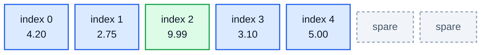
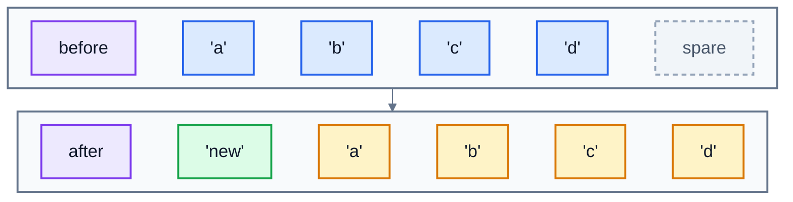

# 2. Arrays and lists

The Python list is the data structure you use most, so it pays to know what's going on inside it. Once you do, the costs from lesson 1 stop being facts to memorise and start making sense.

## An array: one block of memory

In memory, a Python list is an **array**: one continuous row of slots, side by side. Each slot holds a reference to one item. Here's `prices = [4.20, 2.75, 9.99, 3.10, 5.00]`:



Because the slots are all the same size and in a row, Python can find any one instantly. The slot for index `i` is at "start of the block + `i` × slot size". That's one multiplication and one addition, however long the list is. That's why `prices[2]` is **O(1)**: reading the millionth item is as fast as reading the first.

## Appending: usually instant

What happens when the list fills up? Python doesn't grow it one slot at a time. When it runs out of room, it moves the whole list into a bigger block, **with spare slots** (the grey ones above), so the next few appends need no moving at all. You can see it happen by asking for the list's size in memory with `sys.getsizeof`:

```python
import sys
items = []
last = sys.getsizeof(items)
for i in range(17):
    items.append(i)
    size = sys.getsizeof(items)
    if size != last:
        print(f"after {len(items):2} items: {size} bytes")
        last = size
```

```
after  1 items: 88 bytes
after  5 items: 120 bytes
after  9 items: 184 bytes
after 17 items: 248 bytes
```

Python grabbed room for 4 items, then 8, then 16, and so on. An occasional append is slow, because it moves everything, but those are rare enough that appending averages out to **O(1)**. (The exact sizes vary between Python versions; the jumps are what matter.)

## Inserting at the front: everything moves

Inserting anywhere except the end is a different story. To make room at the front, every item has to shift one slot to the right. Here's `items.insert(0, 'new')`:



For a list of `n` items, that's `n` moves: **O(n)**. The same goes for `items.pop(0)` and for `del items[0]`, which shift everything left. The difference is dramatic. On one laptop:

| 100,000 times | Time |
|---|---|
| `items.append(x)` | 0.009 seconds |
| `items.insert(0, x)` | 3.3 seconds |

Same number of items, 360 times slower, purely because of where they went. If you need to add and remove at the front a lot, use a different structure: lesson 4's `deque`.

## Searching a list

`x in items` and `items.index(x)` have no way of knowing where `x` might be, so they check each slot from the start: **O(n)**. If you search the same data often, either sort it and use binary search (lesson 6), or put it in a set or dictionary (lesson 5).

## Two useful patterns

### Two pointers

Many list problems are solved by walking through the list with two positions at once. To remove every `0` from a list **in place**, without the O(n) cost of `remove()` each time, keep a "write" position that only moves forward when you keep an item:

```python
def remove_zeros(items):
    write = 0
    for read in range(len(items)):
        if items[read] != 0:
            items[write] = items[read]
            write += 1
    del items[write:]
```

Each item is looked at once and moved at most once, so it's O(n). Calling `items.remove(0)` in a loop instead would be O(n²), because each `remove` shifts everything after it.

### Sliding window

To find the best total of any `k` days in a row, like the best weekend of sales, you don't need to add up every group of `k` from scratch. Keep a running total of the current "window" of `k` days. To move the window one day along, add the day coming in and subtract the day going out. That's O(n) instead of O(n × k).

## A trap with lists of lists

A grid, like a seating plan, is often a list of lists. Don't build it with `*`:

```python
grid = [[0] * 3] * 3
grid[0][0] = 9
print(grid)
```

```
[[9, 0, 0], [9, 0, 0], [9, 0, 0]]
```

`* 3` copied the *reference* to one inner list three times, so all three rows are the same list. Build each row separately:

```python
grid = [[0] * 3 for _ in range(3)]
grid[0][0] = 9
print(grid)
```

```
[[9, 0, 0], [0, 0, 0], [0, 0, 0]]
```

## Exercise: list algorithms

Open [exercise.py](./exercise.py) and write these functions. Don't use `sorted()` or `sort()` anywhere in this exercise.

| Function | What it does |
|---|---|
| `running_totals(sales)` | returns a new list where each entry is the total so far. `[120, 80, 200]` gives `[120, 200, 400]`. |
| `rotate(items, k)` | returns a new list with every item moved `k` places to the right, wrapping round. `rotate(["Mon", "Tue", "Wed", "Thu"], 1)` gives `["Thu", "Mon", "Tue", "Wed"]`. `k` can be bigger than the list. |
| `remove_all(items, value)` | removes every `value` from the list **in place** (the list you were given changes) in O(n), and returns how many were removed |
| `merge_sorted(a, b)` | takes two lists that are already sorted and returns one sorted list containing both, in O(n + m) |
| `best_window(values, k)` | returns the largest total of any `k` items in a row, in O(n). `best_window([3, 8, 2, 9, 4], 2)` is `13` (9 + 4). If the list has fewer than `k` items, return `None`. |

Run the tests from the lesson folder:

```bash
cd 02-arrays-and-lists
python3 -m unittest -v
```

The tests run `remove_all`, `merge_sorted` and `best_window` on large inputs to check they're O(n).

<details>
<summary>Hint</summary>

- `rotate`: first do `k = k % len(items)`. Then the answer is the last `k` items followed by the rest: two slices joined with `+`. Watch out for an empty list.
- `remove_all`: the two-pointer pattern above, with `value` instead of `0`. The number removed is the original length minus `write`.
- `merge_sorted`: keep an index into each list. Repeatedly take the smaller of the two front items and move that index on. When one list runs out, add whatever's left of the other.
- `best_window`: add up the first `k` values. Then for each next position, `total += values[i] - values[i - k]`, and keep the biggest total seen.

</details>

The full answer is in [solutions/02-arrays-and-lists.py](../solutions/02-arrays-and-lists.py).

## Recap

- A list is an **array**: a row of slots in memory. Reading or changing `items[i]` is O(1).
- `append` and `pop()` at the end are O(1) on average, because the list keeps spare room.
- Inserting or removing at the **front** or middle is O(n): everything after it moves.
- `in` and `index()` on a list are O(n) searches.
- Two pointers and sliding windows turn many O(n²) list problems into O(n) ones.

Next: [3. Linked lists](../03-linked-lists/)
