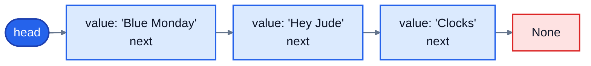
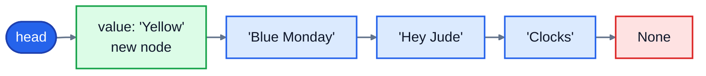
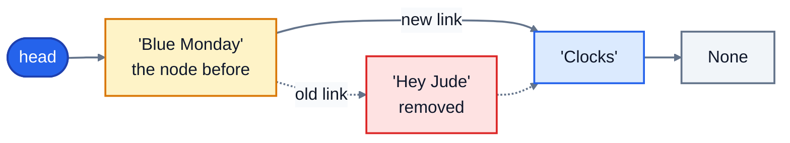

# 3. Linked lists

A Python list keeps its items in one block of memory, which makes reading `items[i]` instant but inserting at the front slow, because everything has to shift. A **linked list** makes the opposite trade. Each item lives in its own little object, a **node**, and each node simply points to the next one.

## Nodes and links

A node holds two things: a value, and a reference to the next node. The last node's `next` is `None`. The list itself only needs to remember the first node, called the **head**.

```python
class Node:
    def __init__(self, value, next=None):
        self.value = value
        self.next = next
```

Here's a playlist of three songs as a linked list:



The nodes can be anywhere in memory. Only the links hold them together, like a treasure hunt where each clue tells you where the next one is.

## Walking the list

To visit every song, start at the head and follow `next` until you reach `None`:

```python
node = playlist.head
while node is not None:
    print(node.value)
    node = node.next
```

That's the basic move for almost everything you do with a linked list.

## Adding to the front: O(1)

To put a song at the start, make a new node whose `next` is the current head, and make it the new head:

```python
playlist.head = Node("Yellow", playlist.head)
```



Nothing else moves. It's two assignments, however long the list is: **O(1)**. On one laptop, adding 100,000 items to the front took 0.03 seconds with a linked list, against 1.8 seconds with `list.insert(0, x)`.

## Removing: relink around it

To remove a song, find the node **before** it and point that node's `next` past it. Here "Hey Jude" is removed:



```python
before.next = before.next.next
```

The removed node is no longer reachable, and Python frees its memory automatically. The relinking itself is O(1), but *finding* the node before it means walking the list, so removing by value is O(n) overall.

Two special cases cause most linked-list bugs, so always think about them:

- **Removing the head.** There's no node before it. Move the head instead: `self.head = self.head.next`.
- **Removing the last node**, or a value that isn't there at all. Make sure your loop stops at `None` instead of trying to read `None.next`, which raises `AttributeError: 'NoneType' object has no attribute 'next'`.

## The catch: no jumping to item i

To reach the 100,000th song, a linked list has to follow 99,999 links from the head. There's no shortcut, because the nodes aren't in a row. That's **O(n)**, compared with O(1) for a Python list. On the same laptop: 10.6 milliseconds to walk to item 99,999 in a linked list, against about 2 microseconds for `items[99999]`.

| Operation | Python list | Linked list |
|---|---|---|
| Read or change item `i` | O(1) | O(n) |
| Add or remove at the front | O(n) | **O(1)** |
| Add at the end | O(1) | O(1), if you keep a reference to the last node |
| Remove a node when you already have the node before it | O(n) | **O(1)** |
| Search for a value | O(n) | O(n) |

So which is better? For most everyday Python, the list, because reading by position is so common, and its memory layout makes it fast in practice. Linked lists win when you add and remove at the ends or in the middle constantly, and never need item `i`. Real examples include the undo history in an editor, the queue of jobs waiting for a printer, and inside other data structures: hash tables (lesson 5) use them, and Python's `collections.deque` is built from linked blocks.

## Doubly linked lists

In a **doubly linked list**, each node also points to the node *before* it (`prev`). That costs a little more memory, but you can walk backwards, and remove a node in O(1) when you have a reference to it, because you can reach its neighbour without walking from the head. Music players use this idea to go to the previous track.

## Keeping track of the size

Counting the nodes means walking the whole list: O(n). If you need the length often, keep a counter in the list object, add 1 when you add a node, and subtract 1 when you remove one. Then `len()` is O(1). The exercise does exactly this.

## Exercise: a playlist

Open [exercise.py](./exercise.py). The `Node` class is written for you. Write a `Playlist` class, a singly linked list of song titles:

| Method | What it does | Speed |
|---|---|---|
| `Playlist()` | an empty playlist: `head` is `None`, and the size is 0 | |
| `add(title)` | adds a song at the **end** | O(1): keep a `tail` reference to the last node |
| `play_next(title)` | adds a song at the **front** | O(1) |
| `remove(title)` | removes the first song with that title, returning `True`, or `False` if it isn't there | O(n) |
| `contains(title)` | `True` if the song is in the playlist | O(n) |
| `len(playlist)` | the number of songs | O(1) |
| `for title in playlist` | goes through the titles in order | |
| `to_list()` | a normal Python list of the titles, in order | O(n) |
| `reverse()` | reverses the playlist **in place**, by relinking the nodes | O(n) |

Don't store the songs in a Python list inside the class: the point is to build the structure from nodes.

Run the tests from the lesson folder:

```bash
cd 03-linked-lists
python3 -m unittest -v
```

Running `python3 exercise.py` builds a small playlist, removes a song and reverses it. When everything works, it prints:

```
['Yellow', 'Blue Monday', 'Clocks']
['Clocks', 'Blue Monday', 'Yellow'] 3
```

<details>
<summary>Hints</summary>

- Keep three attributes: `head`, `tail` and `_size`. In `add`, if the playlist is empty, the new node is both the head and the tail. Otherwise, `self.tail.next = new_node`, then `self.tail = new_node`.
- In `remove`, handle the head separately. For the others, walk with a `previous` and a `current` node. Don't forget to update `tail` if you remove the last node.
- `__iter__` can be a **generator**: walk the list and `yield node.value` for each node. Python turns that into something a `for` loop can use.
- To reverse, walk the list keeping `previous` (starting at `None`). For each node, save `node.next`, point `node.next` back at `previous`, then move both along. At the end, swap `head` and `tail`.

</details>

The full answer is in [solutions/03-linked-lists.py](../solutions/03-linked-lists.py).

## Recap

- A linked list is a chain of **nodes**. Each holds a value and a reference to the next node. The list remembers the **head**.
- Adding or removing at the front is O(1); reaching item `i` is O(n).
- To remove a node, point the node before it past it. Watch the head, the tail, and `None`.
- Python lists are usually the better choice; linked lists win when you constantly add and remove at the ends or in the middle.

Next: [4. Stacks and queues](../04-stacks-and-queues/)
