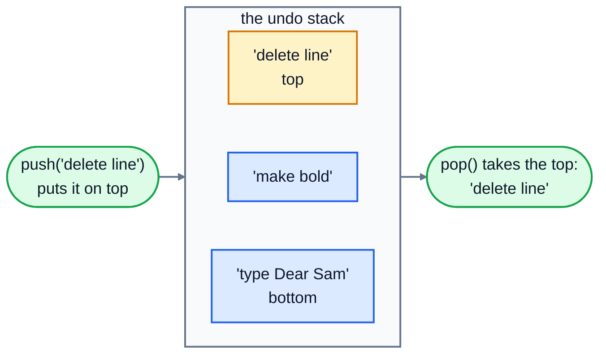
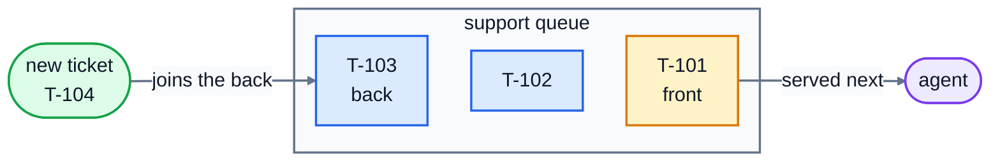

# 4. Stacks and queues

Stacks and queues are lists with one rule added: you can only add and remove items at certain ends. That sounds like a restriction, and it is, but it's a useful one. The rule describes exactly how lots of real things behave, and because you only touch the ends, every operation is O(1).

## Stacks: last in, first out

A **stack** works like a pile of plates. You put a plate on the top (**push**) and take a plate off the top (**pop**). The last plate you put on is the first one you take off. That's called **LIFO**: last in, first out.



A Python list makes a perfect stack, as long as you use the **end** of the list as the top. `append` and `pop()` both work at the end, so both are O(1):

```python
undo_stack = []
undo_stack.append("type 'Dear Sam'")
undo_stack.append("make bold")
undo_stack.append("delete line")
print(undo_stack.pop())   # delete line
print(undo_stack[-1])     # make bold: look at the top without removing it
```

Stacks are everywhere once you look:

- **Undo** in every editor. Each action is pushed; Ctrl+Z pops the most recent one.
- **The back button** in a browser. Each page you visit is pushed; Back pops.
- **Python itself.** When a function calls another function, Python pushes it onto the **call stack**, and pops it when it returns. A traceback is a printout of that stack. If a function calls itself forever, the stack fills up and you get `RecursionError: maximum recursion depth exceeded`.
- **Checking brackets.** Every time you open a bracket, push it. Every time you close one, pop, and check it's the matching kind. This is how your editor highlights a missing `)`.

### Checking brackets step by step

Here's the stack while checking `prices[(i + 1)]`. Only the brackets matter:

| Character | Action | Stack afterwards |
|---|---|---|
| `[` | opening: push | `[` |
| `(` | opening: push | `[ (` |
| `)` | closing: pop gives `(`, which matches | `[` |
| `]` | closing: pop gives `[`, which matches | empty |
| end | the stack is empty, so it's balanced | |

With `print(items[0)]`, the `)` pops a `[`, which doesn't match, so the text isn't balanced. With `((`, the stack still has brackets in it at the end, so it isn't balanced either.

## Queues: first in, first out

A **queue** works like a line at a shop. People join at the **back** (**enqueue**) and are served from the **front** (**dequeue**). The first to arrive is the first served: **FIFO**, first in, first out.



Real queues: support tickets, documents waiting for a printer, orders waiting to be packed, messages waiting to be processed by a server, and songs lined up to play next.

### Don't use a list as a queue

You might try a list: `append` to join the back, `pop(0)` to take from the front. It works, but remember lesson 2: `pop(0)` shifts every remaining item one place left, so it's O(n). On one laptop, emptying a queue of 100,000 items took **1.5 seconds** with `list.pop(0)`.

Python has a type built for this: **`deque`** (say "deck", short for double-ended queue) from the `collections` module. It's made of linked blocks, like lesson 3's linked list, so adding or removing at **either** end is O(1). The same 100,000 items took **0.04 seconds**.

```python
from collections import deque

tickets = deque()
tickets.append("T-101 password reset")     # join the back
tickets.append("T-102 invoice question")
print(tickets.popleft())                    # T-101 password reset: serve the front
print(tickets[0])                           # T-102 invoice question: look without removing
print(len(tickets))                         # 1
```

A deque also has `appendleft` and `pop`, so it can act as a stack too. The one thing it's slower at is reaching the middle: `tickets[5000]` is O(n), just like a linked list.

| Need | Use | Add | Remove |
|---|---|---|---|
| a stack | `list` | `append(x)`: O(1) | `pop()`: O(1) |
| a queue | `collections.deque` | `append(x)`: O(1) | `popleft()`: O(1) |
| a queue, the slow way | `list` | `append(x)`: O(1) | `pop(0)`: **O(n)** |

### Priority queues, briefly

Sometimes "first come, first served" isn't quite right: a ticket saying the website is down should jump ahead of a password reset. If there are only a couple of levels, like "urgent" and "normal", the simplest answer is **one queue per level**: always serve the urgent queue first, and only take from the normal queue when the urgent one is empty. That's what the exercise does. When there are many priority levels, Python's `heapq` module gives you a proper priority queue, but that's beyond this lesson.

## Exercise: undo, brackets and tickets

Open [exercise.py](./exercise.py) and write these three parts.

**1. `UndoHistory`**, the undo and redo of a text editor, using **two stacks**: one of actions you've done, and one of actions you've undone.

| Method | What it does |
|---|---|
| `do(action)` | records a new action. Doing something new also **clears** the redo history, just like a real editor. |
| `undo()` | takes the most recent action off the "done" stack, moves it onto the "undone" stack, and returns it. Returns `None` if there's nothing to undo. |
| `redo()` | the reverse: takes the most recent undone action back onto the "done" stack and returns it, or `None`. |

**2. `is_balanced(text)`** returns `True` if every `(`, `[` and `{` in `text` is closed by the matching bracket in the right order. Any other characters are ignored. The `PAIRS` dictionary is there to help.

**3. `SupportQueue`**, a help desk's ticket queue, with urgent tickets served before normal ones, and each kind served first come, first served.

| Method | What it does |
|---|---|
| `add(ticket, urgent=False)` | adds a ticket to the back of the right queue, in O(1) |
| `next_ticket()` | removes and returns the next ticket to work on, in O(1), or `None` if there are none |
| `peek()` | returns the next ticket without removing it, or `None` |
| `len(queue)` | how many tickets are waiting, urgent and normal together |

Run the tests from the lesson folder:

```bash
cd 04-stacks-and-queues
python3 -m unittest -v
```

The queue is tested with 200,000 tickets. With `list.pop(0)` that takes several seconds and fails; with a deque it's instant.

Running `python3 exercise.py` tries each part. When everything works, it prints:

```
make bold
make bold
True
False
T-103 site is down
T-101 password reset
1
```

<details>
<summary>Hints</summary>

- `UndoHistory.__init__` makes two empty lists. `undo` is "if the done list is empty, return `None`; otherwise pop from it, append to the undone list, and return the action". `redo` is the same with the lists swapped. In `do`, `self._undone.clear()` empties the redo list.
- `is_balanced`: loop over the characters. Push opening brackets. For a closing bracket, if the stack is empty, or `stack.pop()` isn't `PAIRS[character]`, return `False`. At the end, it's balanced only if the stack is empty.
- `SupportQueue` keeps two deques, `self._urgent` and `self._normal`. `next_ticket` tries the urgent one first. An empty deque counts as false, so `if self._urgent:` checks whether it has anything in it.

</details>

The full answer is in [solutions/04-stacks-and-queues.py](../solutions/04-stacks-and-queues.py).

## Recap

- A **stack** is last in, first out. Use a Python list: `append` and `pop()`.
- A **queue** is first in, first out. Use `collections.deque`: `append` and `popleft()`.
- `list.pop(0)` is O(n). Never use a list as a queue for more than a handful of items.
- Stacks power undo, the back button, bracket matching and Python's own function calls. Queues power anything that waits its turn.

Next: [5. Hash tables](../05-hash-tables/)
