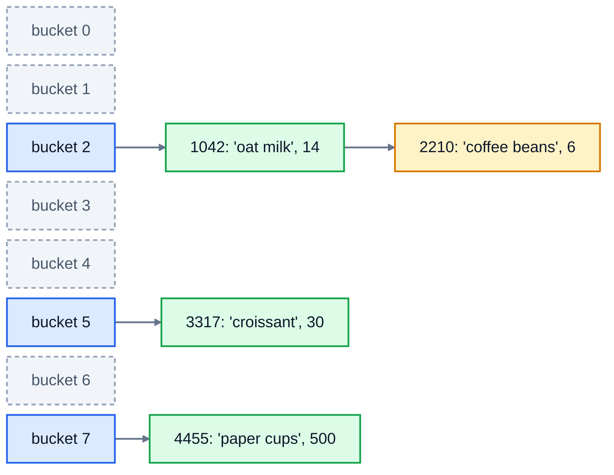

# 5. Hash tables

A Python dictionary can find a key among a million in about the same time it takes to find one among ten. On one laptop, checking whether a number was in a **list** of a million took about 6.5 milliseconds. Checking a **dictionary** of a million took 0.00014 milliseconds, around 45,000 times faster. Sets work the same way.

This lesson shows the trick behind that: the **hash table**. You'll build one yourself.

## The idea: work out where it goes

A list has to search for an item because it could be anywhere. A hash table avoids searching by deciding **where each key lives** from the key itself.

It keeps a row of slots called **buckets**. To store a key, it turns the key into a number using a **hash function**, then uses the remainder after dividing by the number of buckets (`%`) as the bucket index. To find the key later, it does the same sum and goes straight to that bucket. No searching.

Here's a café's stock table with 8 buckets, keyed by product code. In Python, `hash()` of a small whole number is just the number itself, so the sums are easy to follow:

| Key | `hash(key)` | `% 8` | Bucket |
|---|---|---|---|
| 1042 | 1042 | 1042 % 8 | **2** |
| 3317 | 3317 | 3317 % 8 | **5** |
| 4455 | 4455 | 4455 % 8 | **7** |
| 2210 | 2210 | 2210 % 8 | **2** (taken!) |



Each key is stored with its value: the product name and how many are in stock. Grey buckets are empty. Bucket 2 holds two keys, which brings us to collisions.

## Collisions

There are far more possible keys than buckets, so sometimes two keys land in the same bucket. That's a **collision**. 1042 and 2210 both go to bucket 2 above.

The simplest fix is **separate chaining**: each bucket holds a small list of `[key, value]` pairs, and a lookup walks that short list comparing keys with `==`. (Lesson 3's linked lists are the classic way to build those chains.) As long as the chains stay short, finding a key is still O(1): one hash sum, then a check of one or two pairs.

> Python's own `dict` uses a different collision strategy, called **open addressing**: if a key's slot is taken, it tries another slot in the same row. The idea is the same, and so is the result: O(1) on average.

## Keeping it fast: resizing

If you keep adding keys to 8 buckets, the chains get longer and longer. With 30,000 keys, each chain would be nearly 4,000 long, and every lookup would be a slow search again.

So a hash table watches its **load factor**: the number of keys divided by the number of buckets. When it goes over a limit, often 0.75, the table makes a new row with **twice as many buckets** and moves every pair into it. Every key has to be re-hashed, because `hash(key) % 16` is usually different from `hash(key) % 8`.

Resizing is slow, O(n), but it happens less and less often as the table grows, just like a list growing in lesson 2. Averaged out, putting a key in is still O(1).

| Operation | Average | Worst case (everything collides) |
|---|---|---|
| put, get, remove, `in` | O(1) | O(n) |

## What can be a key?

Strings, numbers, tuples of those, and other values that never change can be keys. Lists can't:

```python
>>> stock = {}
>>> stock[["oat", "milk"]] = 14
TypeError: cannot use 'list' as a dict key (unhashable type: 'list')
```

(Older versions of Python say just `unhashable type: 'list'`.)

There's a good reason. A key's bucket is worked out from its hash when you put it in. If you could change a list after using it as a key, its hash would change too, and the table would look in the wrong bucket and never find it again. So Python only lets you hash values that can't change. Use a tuple, `("oat", "milk")`, instead.

One more thing you might notice: `hash("latte")` gives a different number each time you start Python. That's deliberate. Python mixes in a random value at start-up so attackers can't craft thousands of keys that all collide and slow a web server down. Within one run, the hash of a string never changes, which is all a hash table needs.

## When to reach for a dictionary or set

Whenever you find yourself searching a list over and over, ask whether you could look things up by a key instead:

- "Is this email already registered?" Put the emails in a **set**.
- "How many of each product did we sell?" Count into a **dictionary**: `counts[product] = counts.get(product, 0) + 1`.
- "Find the customer with this id." Build a dictionary from id to customer once, then every lookup is O(1).

Lesson 1's exercise was this idea four times over.

## Exercise: build your own dictionary

Open [exercise.py](./exercise.py). It has a `HashMap` class using separate chaining. `__init__` (8 empty buckets and a size of 0), `_bucket(key)` (returns the bucket list a key belongs in) and `bucket_count()` are written for you. Write the rest:

| Method | What it does |
|---|---|
| `put(key, value)` | stores the value. If the key is already there, replace its value. If after adding the table has **more than 0.75 keys per bucket**, call `_resize` with double the number of buckets. |
| `get(key, default=None)` | returns the value, or `default` if the key isn't there |
| `remove(key)` | removes the pair and returns `True`, or returns `False` if the key isn't there |
| `key in table` | `__contains__`: `True` if the key is there |
| `len(table)` | the number of keys, in O(1) |
| `keys()` | a list of all the keys, in any order |
| `_resize(capacity)` | makes `capacity` new empty buckets and moves every pair into the right one |

Don't use a `dict` or `set` anywhere in the class: the tests check.

Run the tests from the lesson folder:

```bash
cd 05-hash-tables
python3 -m unittest -v
```

The speed test puts and gets 30,000 keys. Without resizing, that takes about four seconds and fails. With it, it's well under a second.

Running `python3 exercise.py` tries it out. When everything works, it prints:

```
38 0
True 2
22 32
```

The last line shows that after 22 keys, the table has grown from 8 buckets to 16, and then to 32.

<details>
<summary>Hints</summary>

- In `put`, get the bucket with `self._bucket(key)`. Loop over its pairs: if `pair[0] == key`, set `pair[1] = value` and return. Otherwise append `[key, value]`, add 1 to `self._size`, then check `self._size > len(self._buckets) * 0.75`.
- `get` and `__contains__` both loop over one bucket. Don't check `if self.get(key)` in `__contains__`: a stored value of `0` or `None` would look missing.
- In `remove`, loop with an index so you can `bucket.pop(i)`.
- In `_resize`, keep a reference to the old buckets, make the new empty ones, then put each old pair into `self._bucket(key)`. Don't call `put` from `_resize`: it would change the size and could resize again in the middle.

</details>

The full answer is in [solutions/05-hash-tables.py](../solutions/05-hash-tables.py).

## Recap

- A hash table turns each key into a bucket number with `hash(key) % number_of_buckets`, so it can go straight to the right place: O(1) on average.
- Two keys in one bucket is a **collision**. Chaining keeps a short list of pairs in each bucket.
- When the load factor gets too high, the table doubles its buckets and re-hashes every key, which keeps the chains short.
- Keys must be hashable: strings, numbers and tuples, but not lists.
- Python's `dict` and `set` are hash tables. Use them whenever you'd otherwise search a list again and again.

Next: [6. Searching](../06-searching/)
