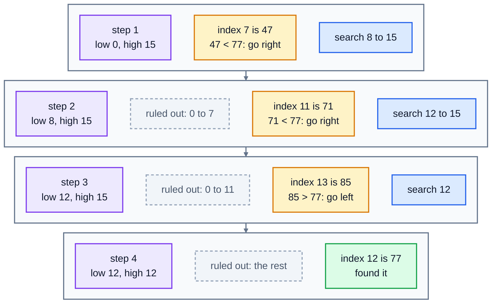

# 6. Searching

A web server writes a line to its log for every request. On a busy day that's millions of lines. When customers say checkout broke "about 9:35 this morning", you need to jump straight to 9:35, not read from midnight onwards. This lesson is about the two basic ways of finding things, and why one of them is dramatically faster when the data is sorted.

## Linear search

The simplest search checks each item in turn until it finds the one it wants:

```python
def linear_search(items, target):
    for i in range(len(items)):
        if items[i] == target:
            return i
    return -1
```

It works on any list, sorted or not. But in the worst case, when the item is at the end or not there at all, it checks all `n` items: **O(n)**. Python's `in` and `list.index()` do exactly this. On one laptop, `index()` took 11 milliseconds to find the last item in a list of a million.

## Binary search

If the list is **sorted**, you can do much better. You do it yourself when you look up a word in a paper dictionary: open it near the middle, see whether your word comes before or after that page, and throw away the half it can't be in. Then repeat with the half that's left.

In code, keep two positions, `low` and `high`, marking the part of the list the item could still be in. Look at the middle item:

- If it's the target, you've found it.
- If it's **smaller** than the target, the target must be to the right: move `low` to just after the middle.
- If it's **bigger**, the target must be to the left: move `high` to just before the middle.
- If `low` passes `high`, there's nothing left to search, so the target isn't there.

Here's a search for `77` in a sorted list of 16 numbers:

`[3, 8, 12, 19, 23, 31, 40, 47, 52, 58, 64, 71, 77, 85, 90, 96]`



The amber box in each step is the middle item being checked. Four steps instead of thirteen. The middle is `(low + high) // 2`, rounded down, which is why step 1 looks at index 7.

```python
def binary_search(items, target):
    low = 0
    high = len(items) - 1
    while low <= high:
        middle = (low + high) // 2
        if items[middle] == target:
            return middle
        if items[middle] < target:
            low = middle + 1
        else:
            high = middle - 1
    return -1
```

Each step halves what's left, so a list of `n` items needs at most about log₂ n steps: **O(log n)**. That's 20 steps for a million items, 30 for a billion. On the same laptop, binary search found the last item in a million in **0.002 milliseconds**, over 5,000 times faster than `index()`.

| Items | Linear search, worst case | Binary search, worst case |
|---|---|---|
| 1,000 | 1,000 checks | 10 |
| 1,000,000 | 1,000,000 | 20 |
| 1,000,000,000 | 1,000,000,000 | 30 |

### The catch: it must be sorted

Binary search only works because a sorted list tells you which half to throw away. On an unsorted list it gives wrong answers, with no error. Sorting costs O(n log n) (lesson 7), so it's worth it when you search the same data many times. For a single search of unsorted data, a linear search is fine. And if you only ever need "is this exact key here?", a set or dictionary (lesson 5) is even faster at O(1).

### Two classic bugs

- **Off by one.** `high` starts at `len(items) - 1`, the last valid index, and the loop runs while `low <= high`. Using `<` misses the case where one item is left, as in step 4 above.
- **Slicing instead of moving positions.** `binary_search(items[middle + 1:], target)` looks neat, but every slice copies half the list, which is O(n) work. Move `low` and `high` instead.

## Finding a range: where does 9:35 start?

Log timestamps are usually written like `2026-03-14T09:35:06`: year, month, day, then the time, each with a fixed number of digits. That format has a handy property: **sorting the strings alphabetically also sorts them by time**. So you can compare them with `<` and use binary search directly on the strings.

Often you don't want one exact entry, you want a range: everything from 09:35:00 to 09:35:59. The exact second 09:35:00 might not be in the log at all. What you need is a slight change to binary search that finds a **boundary**:

- `first_at_or_after(timestamps, start)`: the position of the first entry that's `>= start`. Everything before it is too early.
- `first_after(timestamps, end)`: the position of the first entry that's `> end`. Everything from there on is too late.

The entries you want are the slice between those two positions, and the number of them is one position minus the other.

The boundary version keeps `low` and `high` closing in on a position, rather than stopping when it finds a match:

```python
def first_at_or_after(timestamps, start):
    low = 0
    high = len(timestamps)
    while low < high:
        middle = (low + high) // 2
        if timestamps[middle] < start:
            low = middle + 1     # middle is too early, so the answer is after it
        else:
            high = middle        # middle might be the answer, so keep it in range
    return low
```

Notice the differences: `high` starts at `len(timestamps)` (the answer can be "past the end"), the loop runs while `low < high`, and `high` becomes `middle`, not `middle - 1`. When the loop ends, `low` and `high` are equal and point at the boundary.

In real projects you'd use Python's **`bisect`** module for this: `bisect.bisect_left` is `first_at_or_after`, and `bisect.bisect_right` is `first_after`. Writing them yourself once is the best way to understand what they do.

## Exercise: search a server log

The lesson folder has [server.log](./server.log), an hour of requests to a café's ordering website, one per line:

```
2026-03-14T09:35:06 POST /checkout 500
```

Open [exercise.py](./exercise.py). `read_log(path)` is written for you: it returns a list of `(timestamp, message)` pairs. Write these functions. Every list they get is already sorted, except in `linear_search`.

| Function | What it returns |
|---|---|
| `linear_search(items, target)` | the index of the first `target`, or `-1` |
| `binary_search(items, target)` | the index of `target` in a sorted list, or `-1`, in O(log n) |
| `first_at_or_after(timestamps, start)` | the index of the first timestamp `>= start`, or `len(timestamps)` if there's none, in O(log n) |
| `first_after(timestamps, end)` | the index of the first timestamp `> end`, or `len(timestamps)` if there's none, in O(log n) |
| `count_between(timestamps, start, end)` | how many timestamps are between `start` and `end`, both included, in O(log n) |

Don't use `in`, `.index()` or the `bisect` module in the four search functions. The tests check, and they also time each function on a sorted list of a million items.

Run the tests from the lesson folder:

```bash
cd 06-searching
python3 -m unittest -v
```

Running `python3 exercise.py` pulls out the requests from the checkout incident at 9:35. When everything works, it prints:

```
87 entries
2026-03-14T09:35:06 POST /checkout 500
2026-03-14T09:35:17 POST /login 401
2026-03-14T09:35:29 POST /checkout 500
2026-03-14T09:35:43 POST /checkout 500
84 entries between 9 and 10
```

<details>
<summary>Hints</summary>

- `binary_search` is the code above. Type it out yourself rather than copying it, and trace the 16-number example by hand.
- `first_after` is `first_at_or_after` with one change: an entry equal to `end` is still "too early", so the comparison becomes `<=`.
- `count_between` is one line: `first_after(...) - first_at_or_after(...)`.
- If a boundary function loops forever, check that `low` always moves to `middle + 1`, never to `middle`.

</details>

The full answer is in [solutions/06-searching.py](../solutions/06-searching.py).

## Recap

- **Linear search** checks every item: O(n). It works on any list.
- **Binary search** halves the sorted range each step: O(log n). Twenty steps for a million items.
- Binary search needs **sorted** data, and gives wrong answers without it.
- A small change finds **boundaries**, which lets you pull out a range of sorted data, like log entries between two times, in O(log n).
- In real code, use the `bisect` module.

Next: [7. Sorting](../07-sorting/)
