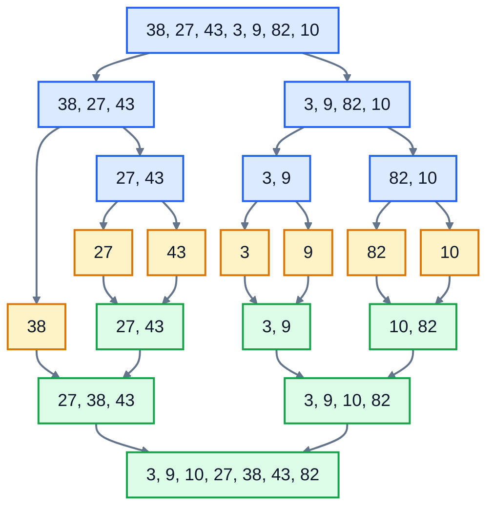

# 7. Sorting

An online shop shows products "sorted by rating". A bank statement lists transactions by date. A leaderboard ranks players by score. Sorting is everywhere, and as lesson 6 showed, sorted data can be searched in O(log n).

In real code you'll almost always call Python's `sorted()`. But how sorting works is worth knowing: it's the clearest example there is of a smart algorithm beating a simple one by a huge margin. This lesson builds three sorts, then shows how to use `sorted()` properly.

## How much does the algorithm matter?

Here's how long four ways of sorting took on one laptop:

| Algorithm | 1,000 numbers | 10,000 numbers | Big O |
|---|---|---|---|
| Bubble sort | 0.05 seconds | 4.4 seconds | O(n²) |
| Insertion sort | 0.03 seconds | 1.6 seconds | O(n²) |
| Merge sort | 0.003 seconds | 0.018 seconds | O(n log n) |
| Python's `sorted()` | 0.0001 seconds | 0.0012 seconds | O(n log n) |

Ten times the data made the O(n²) sorts 50 to 80 times slower, but merge sort only about 6 times slower. With a million numbers, bubble sort would take most of a day. `sorted()` takes well under a second.

## Bubble sort

Walk through the list comparing each pair of neighbours, and swap them if they're the wrong way round. After one pass, the biggest item has "bubbled up" to the end. Repeat for the rest of the list.

```python
def bubble_sort(items):
    for end in range(len(items) - 1, 0, -1):
        for i in range(end):
            if items[i] > items[i + 1]:
                items[i], items[i + 1] = items[i + 1], items[i]
```

It's easy to understand, and that's its only advantage. A loop inside a loop over the list: O(n²). It's here so you'll recognise it, not so you'll use it.

## Insertion sort

This is how most people sort a hand of playing cards. Pick up the cards one at a time, and slide each new card left past the bigger ones until it's in the right place. The cards on the left are always sorted.

Here's insertion sort on some prices. The **bold** item is the one being placed; everything to its left is already sorted:

| Step | List | What happens |
|---|---|---|
| start | 24.99, **6.50**, 89.00, 18.00, 54.99 | |
| 1 | 6.50, 24.99, **89.00**, 18.00, 54.99 | 6.50 slid left past 24.99 |
| 2 | 6.50, 24.99, 89.00, **18.00**, 54.99 | 89.00 is bigger than 24.99, so it stays |
| 3 | 6.50, 18.00, 24.99, 89.00, **54.99** | 18.00 slid left past 89.00 and 24.99 |
| 4 | 6.50, 18.00, 24.99, 54.99, 89.00 | 54.99 slid left past 89.00. Done. |

```python
def insertion_sort(items):
    for i in range(1, len(items)):
        value = items[i]
        j = i - 1
        while j >= 0 and items[j] > value:
            items[j + 1] = items[j]     # shift the bigger item one place right
            j -= 1
        items[j + 1] = value            # drop the value into the gap
```

In the worst case, a list in reverse order, every item slides all the way to the start: O(n²). But look at step 2: if an item is already in place, the `while` loop stops at once. So on a list that's **already sorted, or nearly sorted**, insertion sort is O(n), and very fast. That's why real sorting libraries use it for small or nearly sorted pieces of data.

## Merge sort

Merge sort uses an idea called **divide and conquer**:

- Split the list in half.
- Sort each half (by splitting those in half too, and so on, until each piece has one item, which is already sorted).
- **Merge** the two sorted halves into one sorted list.

The merge step is lesson 2's `merge_sorted`: keep a position in each half, and repeatedly take the smaller of the two front items. Here's merge sort on seven numbers. The blue boxes split; the green boxes merge.



The amber boxes are single items: the point where splitting stops.

```python
def merge_sort(items):
    if len(items) <= 1:
        return list(items)
    middle = len(items) // 2
    left = merge_sort(items[:middle])
    right = merge_sort(items[middle:])
    return merge(left, right)
```

`merge_sort` calls itself. That's **recursion**: a function solving a problem by solving smaller copies of the same problem. It always needs a **base case** that stops it, here "a list of 0 or 1 items is already sorted". Without one, it would call itself until Python stops it with a `RecursionError`.

Why O(n log n)? Halving the list again and again gives about log₂ n levels of splitting (3 levels for 7 items, 20 for a million). At each level, merging touches every item once, which is O(n) work per level. So the total is n × log n.

Merge sort makes new lists as it goes, so it uses O(n) extra memory. Insertion sort works inside the original list.

## Sorting in real code

Python's `sorted()` and `list.sort()` use an algorithm called **Timsort**, a carefully tuned mix of merge sort and insertion sort. It's O(n log n), it's especially quick on data that's partly sorted already, and it's written in C. Use it.

```python
prices = [24.99, 6.50, 89.00]
print(sorted(prices))                 # a new list: [6.5, 24.99, 89.0]
prices.sort(reverse=True)             # sorts this list in place, biggest first
```

### Sorting by a key

To sort complicated things, like products, give `sorted()` a **key**: a function that turns each item into the value to sort by.

```python
products = [
    {"name": "Travel mug", "rating": 4.6, "price": 18.00},
    {"name": "Coffee scale", "rating": 4.8, "price": 32.00},
]
by_price = sorted(products, key=lambda product: product["price"])
```

`lambda product: product["price"]` is a small function with no name: it takes a product and gives back its price.

### Sorting by more than one thing

To rank products by rating, and break ties by number of reviews, make the key a **tuple**. Python compares tuples one item at a time, moving on only when the earlier items are equal. To sort a number from biggest to smallest inside the tuple, make it negative:

```python
ranked = sorted(products, key=lambda product: (-product["rating"], -product["reviews"], product["name"]))
```

That's "highest rating first, then most reviews first, then name from A to Z".

### Stable sorting

Python's sort is **stable**: items that compare as equal keep the order they were in. That's why merge takes from the **left** half when two items are equal. Stability matters when you sort data that's already in a meaningful order: sort orders by customer, and each customer's orders stay in date order.

## Exercise: sort and rank

Open [exercise.py](./exercise.py). It has a `PRODUCTS` list from a coffee equipment shop. Write these functions:

| Function | What it does |
|---|---|
| `insertion_sort(items)` | sorts `items` **in place**, smallest first, with insertion sort. It should be fast on a list that's already sorted. |
| `merge(left, right)` | merges two sorted lists into one new sorted list. When two items are equal, take the one from `left` first. |
| `merge_sort(items)` | returns a **new** sorted list, using `merge`. Don't change `items`. |
| `rank_products(products)` | returns a new list: highest `rating` first, then most `reviews`, then `name` from A to Z |
| `cheapest(products, count)` | returns the names of the `count` cheapest products, cheapest first |

Don't use `sorted()` or `.sort()` in the first three. In the last two, do: that's how it's done in real code.

Run the tests from the lesson folder:

```bash
cd 07-sorting
python3 -m unittest -v
```

The tests time `merge_sort` on 10,000 random numbers, and `insertion_sort` on 10,000 numbers that are already in order.

Running `python3 exercise.py` tries each function. When everything works, it prints:

```
[6.5, 18.0, 24.99, 54.99, 89.0]
[3, 9, 10, 27, 38, 43, 82]
4.8    312  Coffee scale
4.8    312  Pour-over kettle
4.6   2045  Burr grinder
4.6   1280  Travel mug
4.4    870  Paper filters
4.1   1990  Milk frother
['Paper filters', 'Travel mug', 'Milk frother']
```

The coffee scale and the kettle have the same rating and the same number of reviews, so the name decides.

<details>
<summary>Hints</summary>

- `insertion_sort` is the code above. The `while` loop's `items[j] > value` check is what makes it fast on sorted input. If you use a `for` loop that always runs back to the start, it won't be.
- `merge`: use `<=` (not `<`) when comparing `left[i]` with `right[j]`, so equal items come from the left. After the loop, one list still has items left; `result.extend(left[i:])` and `result.extend(right[j:])` add whatever remains.
- `merge_sort`: return `list(items)` for the base case, so you always return a new list.
- `cheapest`: sort by price, take a slice `[:count]`, then collect the names.

</details>

The full answer is in [solutions/07-sorting.py](../solutions/07-sorting.py).

## Recap

- **Bubble sort** and **insertion sort** are O(n²). Insertion sort is O(n) on data that's already nearly sorted.
- **Merge sort** splits, sorts the halves, and merges: O(n log n), using recursion.
- In real code, use `sorted()` or `.sort()`. They're O(n log n), stable, and fast.
- Sort complicated things with `key=`. Use a tuple key for tie-breaks, and a negative number to reverse one part.

Next: [8. Trees](../08-trees/)
