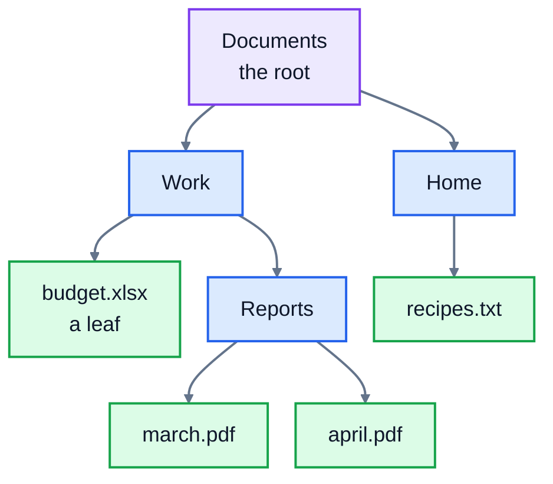
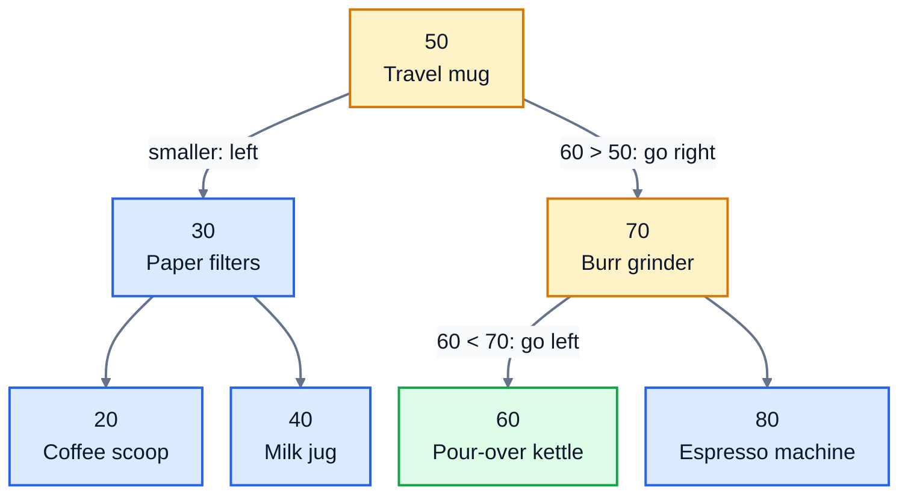
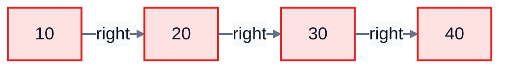

# 8. Trees

So far every structure has been a line: one item after another. A **tree** branches. You use trees every day without calling them that: the folders on your computer, the headings and subheadings of a document, a company's org chart, and the HTML of every web page.

## Tree words



- Each box is a **node**. The lines between them are **edges**.
- The node at the top is the **root**. (Computer scientists draw trees upside down.)
- A node's **children** are the nodes directly below it, and it's their **parent**. "Work" is the parent of "budget.xlsx" and "Reports".
- A node with no children is a **leaf**, like the files here.
- Every node except the root has exactly one parent, and there are no loops.
- The **height** is the number of levels: 4 here, from "Documents" down to "march.pdf".

## Binary search trees

A **binary tree** is a tree where each node has at most two children, called **left** and **right**. A **binary search tree** (BST) adds one rule that makes it useful for finding things:

> For every node, everything in its **left** branch is **smaller**, and everything in its **right** branch is **bigger**.

Here's a BST of a shop's products, keyed by product code:



To find product 60, start at the root and let the rule steer you. 60 is bigger than 50, so go right. 60 is smaller than 70, so go left. Found it, after looking at three of the seven nodes (the amber path). It's binary search again, but built into the shape of the data.

Each node is a small object, like lesson 3's linked-list nodes, with two links instead of one:

```python
class TreeNode:
    def __init__(self, key, value):
        self.key = key
        self.value = value
        self.left = None
        self.right = None
```

### Finding a key

Walk down from the root, turning left or right at each node, until you find the key or fall off the bottom (`None`):

```python
node = self.root
while node is not None:
    if key == node.key:
        return node.value
    if key < node.key:
        node = node.left
    else:
        node = node.right
return None   # fell off the bottom: it isn't there
```

### Inserting

Inserting follows exactly the same path as finding. When you reach a `None` where the key would be, put a new node there. So the **order you insert keys decides the tree's shape**. The tree above came from inserting 50, 30, 70, 20, 40, 60, 80: 50 became the root, 30 went to its left, 70 to its right, and so on.

### Walking the tree in order

To visit every key from smallest to largest, use **recursion**: for each node, first visit everything on its left (all smaller), then the node itself, then everything on its right (all bigger).

```python
def _in_order(self, node, pairs):
    if node is None:
        return
    self._in_order(node.left, pairs)
    pairs.append((node.key, node.value))
    self._in_order(node.right, pairs)
```

On the tree above, that gives 20, 30, 40, 50, 60, 70, 80. A BST is a list that's always sorted, however you add to it.

The smallest key is easy too: keep going left until there's no left child. The largest: keep going right.

## How fast is it? It depends on the shape

Each step down the tree is one comparison, so finding or inserting a key costs as many steps as the tree is tall.

If the tree is **balanced**, with branches of similar length, each level roughly doubles the number of nodes. A million keys fit in about 20 levels, so searching is **O(log n)**, like binary search, and inserting is O(log n) too. That's the big win over a sorted list, where inserting in the middle is O(n).

But look what happens when you insert keys that are **already in order**, like 10, 20, 30, 40:



Each new key is bigger than everything so far, so it goes right every time. The "tree" is really a linked list with a height of `n`, and searching it is **O(n)**. This happens in real life: product codes are often handed out in order.

| Tree shape | Height for n keys | Search and insert |
|---|---|---|
| Balanced | about log₂ n | O(log n) |
| One long chain (keys inserted in order) | n | O(n) |

The fix is a **self-balancing** tree, such as an AVL tree or a red-black tree, which rotates nodes around after each insert to keep the height near log n. Databases use a close relative, the **B-tree**, for their indexes: it's why looking up a row by its id is fast in a table of millions. Those are beyond this lesson, but now you know what they're for.

### What about removing?

Removing a leaf is easy: point its parent's link at `None`. Removing a node with one child is nearly as easy: point the parent at that child. Removing a node with **two** children is the tricky one. The usual trick is to replace its key and value with the next biggest key (the smallest key in its right branch), then remove that node instead, which has at most one child. The exercise leaves removal out, but try it as an extra challenge.

### Do I need to write one in Python?

Rarely. Python doesn't have a built-in tree, and for most jobs a dictionary (for lookups) plus `sorted()` (when you need order) is simpler and faster. Trees matter because they're inside the tools you use: database indexes, file systems, and the way your browser stores a web page. And tree-shaped data, like folders or JSON, turns up all the time, and the recursive pattern above is how you work through it.

## Exercise: a product index

Open [exercise.py](./exercise.py). `TreeNode` and `ProductIndex.__init__` are written for you. Write the rest of `ProductIndex`, a binary search tree from product codes to product names:

| Method | What it does |
|---|---|
| `insert(key, value)` | adds a product in the right place. If the key is already there, replace its value. |
| `get(key, default=None)` | returns the value for `key`, or `default` |
| `key in index` | `__contains__`: whether the key is in the tree |
| `len(index)` | the number of products |
| `smallest()`, `largest()` | the smallest and largest key, or `None` if the tree is empty |
| `in_order()` | a list of `(key, value)` pairs, smallest key first. Use the `_in_order` helper. |
| `between(low, high)` | a list of the keys from `low` to `high`, both included, smallest first. Use the `_between` helper. |
| `height()` | the number of levels: 0 for an empty tree, 1 for a root on its own. Use the `_height` helper. |

Run the tests from the lesson folder:

```bash
cd 08-trees
python3 -m unittest -v
```

The tests check the tree's shape, so smaller keys really must go left. They also insert 30,000 random keys and look each one up, which takes well under a second with a proper BST.

Running `python3 exercise.py` builds the tree in the diagram above. When everything works, it prints:

```
Pour-over kettle 7 3
20 80
[40, 50, 60]
[20, 30, 40, 50, 60, 70, 80]
```

<details>
<summary>Hints</summary>

- `insert`: if the tree is empty, the new node is the root. Otherwise walk down like `get` does. Before moving left, check whether `node.left` is `None`: if it is, put the new node there and stop. The same for right. Remember to add 1 to `self._size`, but only for a new key.
- `in_order` makes an empty list, calls `self._in_order(self.root, pairs)`, and returns the list.
- `_between` is `_in_order` with two shortcuts. Only go left if `low < node.key` (otherwise everything on the left is too small). Only add the node if `low <= node.key <= high`. Only go right if `node.key < high`.
- `_height(node)` is 0 for `None`, otherwise `1 + max(` the height of the left branch `,` the height of the right branch `)`.

</details>

The full answer is in [solutions/08-trees.py](../solutions/08-trees.py).

## Recap

- A **tree** is nodes connected parent to child, starting from one **root**, with no loops. **Leaves** have no children.
- In a **binary search tree**, smaller keys go left and bigger keys go right, at every node.
- Finding and inserting follow one path down: O(log n) when the tree is balanced, O(n) when it's a chain.
- Visiting left, then the node, then right gives the keys in sorted order.
- Real systems use **self-balancing** trees and **B-trees** so the height stays small whatever order the data arrives in.

Next: [9. Graphs](../09-graphs/)
