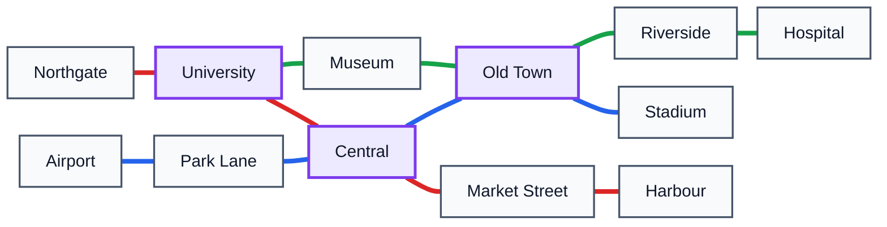
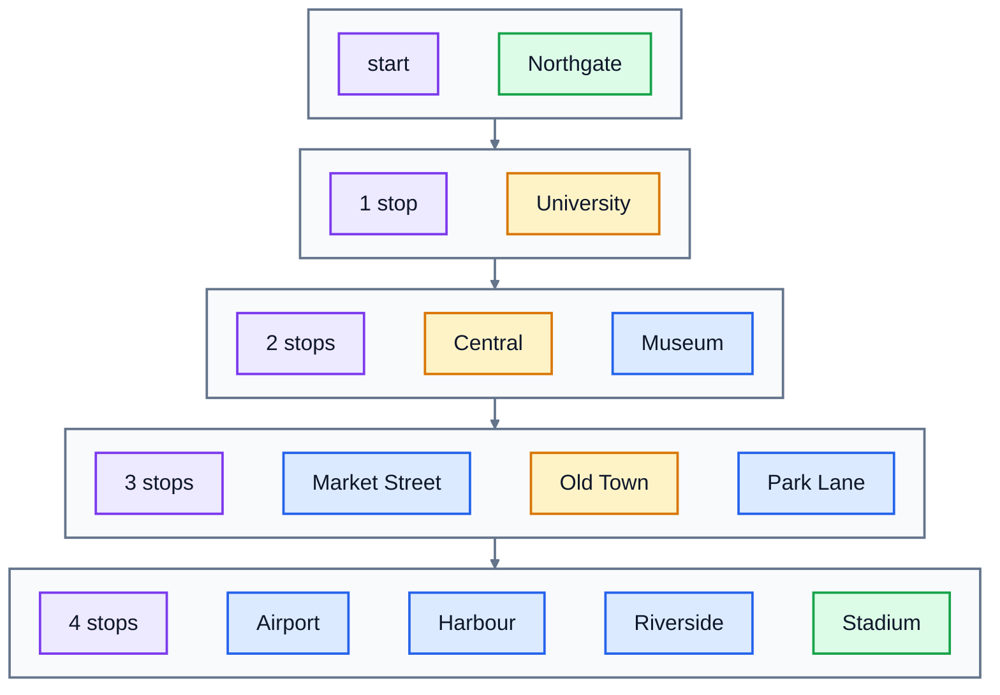

# 9. Graphs

A **graph** is a set of things and the connections between them. That's all, and it describes a surprising amount of the world:

| Things (nodes) | Connections (edges) |
|---|---|
| metro stations | tracks between them |
| people on a social network | who follows or knows whom |
| web pages | links |
| cities | roads, with distances |
| Python packages | "this package needs that one" |

A tree from lesson 8 is a graph too, a very tidy one, with a root and no loops. General graphs can have loops, many paths between two nodes, and parts that aren't connected at all. This lesson uses a small city's metro map, and answers the question every journey planner answers: **how do I get from here to there?**

## The metro map

[metro.txt](./metro.txt) describes three lines:

```
Red: Northgate, University, Central, Market Street, Harbour
Blue: Airport, Park Lane, Central, Old Town, Stadium
Green: University, Museum, Old Town, Riverside, Hospital
```

Drawn as a graph, with interchange stations in purple:



The **red**, **blue** and **green** lines are the three metro lines. The graph doesn't care about lines, only which stations are next to each other. The tracks go both ways, so this is an **undirected** graph. (On a one-way street map or a "follows" network, edges have a direction, and the graph is **directed**.)

## Storing a graph: the adjacency list

The usual way to store a graph is an **adjacency list**: a dictionary from each node to the set of nodes it's connected to.

```python
links = {
    "Northgate": {"University"},
    "University": {"Northgate", "Central", "Museum"},
    "Central": {"University", "Market Street", "Park Lane", "Old Town"},
    # ... and so on for every station
}
```

Finding a station's neighbours is a dictionary lookup, O(1), and the whole thing takes memory in proportion to the number of stations plus tracks. Because the tracks go both ways, connecting A to B means adding B to A's set **and** A to B's set.

The other common option is an **adjacency matrix**, a grid with a row and a column per node, and a 1 where two nodes are connected. It's handy for small, dense graphs, but for a city with 1,000 stations it's a million cells, almost all 0.

## Breadth-first search: the fewest stops

To find the route with the fewest stops, explore outwards from the start in rings: first every station 1 stop away, then every station 2 stops away, and so on. The first time you reach the goal, you've found a shortest route, because you've already checked everything closer. This is **breadth-first search** (BFS).

Here are the rings from Northgate:



Stadium is 4 stops away. The amber stations are the route: Northgate, University, Central, Old Town, Stadium. (Hospital is 5 stops away, in the next ring.)

BFS needs two things from earlier lessons:

- A **queue** (lesson 4), so stations are explored in the order they were found, nearest first. Use a `deque`.
- A **dictionary** (lesson 5) recording where you came from: `came_from["Central"] = "University"` means "I first reached Central from University". It also tells you which stations you've already seen, so you never explore one twice. Without that, you'd go round loops forever, Central to Old Town to Museum to University to Central...

```python
from collections import deque

came_from = {start: None}
queue = deque([start])
while queue:
    station = queue.popleft()
    if station == goal:
        break                          # found it: now rebuild the route
    for neighbour in neighbours(station):
        if neighbour not in came_from:
            came_from[neighbour] = station
            queue.append(neighbour)
```

To get the route, start at the goal and follow `came_from` backwards until you reach `None` (the start), then reverse the list: Stadium came from Old Town, Old Town from Central, Central from University, University from Northgate.

Every station and every track is handled at most once, so BFS is **O(V + E)**, where V is the number of nodes (vertices) and E the number of edges.

### Ties

Stadium can also be reached in 4 stops through Museum. Which route BFS returns depends on the order it looks at neighbours. In the exercise, neighbours are explored in alphabetical order, so the answer is always the same: University's neighbours are Central, Museum, Northgate, so Central is reached first.

## Depth-first search: what can I reach?

Sometimes you don't need the shortest route, just **whether** you can get somewhere. Say Central is closed for repairs. Which stations can you still reach from Harbour?

**Depth-first search** (DFS) answers this. It's BFS with a **stack** instead of a queue: it follows one path as far as it can go, then backs up and tries the next branch, like exploring a maze with one hand on the wall.

```python
seen = {start}
stack = [start]
while stack:
    station = stack.pop()
    for neighbour in neighbours(station):
        if neighbour not in seen and neighbour not in closed:
            seen.add(neighbour)
            stack.append(neighbour)
```

With Central closed, starting from Harbour you can reach Market Street, and then you're stuck: the set is `{"Harbour", "Market Street"}`. DFS is also O(V + E), and it's often written with recursion instead of a stack. For "what can I reach?", BFS and DFS give the same set; they just visit the stations in a different order.

| | Breadth-first search | Depth-first search |
|---|---|---|
| Explores | nearest first, in rings | one path as deep as it goes, then backs up |
| Uses | a queue (`deque`) | a stack (a list, or recursion) |
| Good for | fewest steps: routes, "degrees of separation" | reachability, mazes, checking for loops |

## Beyond this lesson

Real journey planners care about **time**, not stops: a fast express hop might beat three slow local stops. That's a **weighted** graph, where each edge has a number, and the classic algorithm for it is **Dijkstra's algorithm**, a BFS that always explores the closest unexplored station next, using a priority queue (`heapq`). Mapping apps use Dijkstra's algorithm and its faster relative A\*. Once you're comfortable with BFS, it's the natural next step.

## Exercise: a journey planner

Open [exercise.py](./exercise.py). The `MetroMap` class stores its graph as an adjacency list in `self._links`. `add_station`, `connect(a, b)` (which connects in both directions), `stations()` and `load_map(path)` are written for you. Write the rest:

| Method | What it does |
|---|---|
| `add_line(stations)` | connects each station in the list to the next one |
| `neighbours(station)` | a **sorted** list of the stations one stop away |
| `fewest_stops(start, goal)` | the route with the fewest stops, as a list of stations from `start` to `goal`, using BFS. Explore neighbours in the order `neighbours()` gives. Return `None` if there's no route, or if either station isn't on the map. |
| `reachable(start, closed=())` | the **set** of stations you can reach from `start` without passing through a station in `closed`. If `start` itself is closed or isn't on the map, return an empty set. |

Run the tests from the lesson folder:

```bash
cd 09-graphs
python3 -m unittest -v
```

As well as the city map, the tests use a 100 × 100 grid of 10,000 stations, which BFS and DFS should cross in well under a second.

Running `python3 exercise.py` loads the map and plans some journeys. When everything works, it prints:

```
12 stations
['Market Street', 'Old Town', 'Park Lane', 'University']
Northgate -> University -> Central -> Old Town -> Stadium
Airport -> Park Lane -> Central -> Old Town -> Riverside -> Hospital
['Harbour', 'Market Street']
```

<details>
<summary>Hints</summary>

- `add_line` loops over positions `0` to `len(stations) - 2` and calls `self.connect(stations[i], stations[i + 1])`.
- `neighbours` is `sorted(self._links[station])`.
- `fewest_stops`: use the BFS code above. When `station == goal`, build the route: `route = []`, then while `station is not None`, append it and move to `came_from[station]`. Reverse and return. If the loop finishes without finding the goal, return `None`. Check that both stations are in `self._links` before you start.
- `reachable` is the DFS code above. Return `seen`.

</details>

The full answer is in [solutions/09-graphs.py](../solutions/09-graphs.py).

## Recap

- A **graph** is nodes and edges. Edges can be **undirected** or **directed**, and **weighted** or not.
- Store a graph as an **adjacency list**: a dictionary from each node to its neighbours.
- **Breadth-first search** uses a queue and finds the fewest steps. **Depth-first search** uses a stack and finds what's reachable. Both are O(V + E).
- Always remember which nodes you've seen, in a set or dictionary, or you'll go round in loops.

## What's next

That's the whole course. You can now judge how fast code is before you run it, and you've built the structures that sit underneath almost every program: arrays, linked lists, stacks, queues, hash tables, trees and graphs. Good next steps are practice problems on sites like LeetCode or Exercism, which are mostly these ideas in new combinations, and the algorithms this course pointed at: heaps and priority queues, Dijkstra's algorithm, and balanced trees.
